# Capitan — Build Progress Log

A running record of work done by Claude Code, for later review. Newest work is
summarized in the status table; details follow per milestone. Design authority is
`rc/Capitan — Design Document v2.md` (Status: Draft v4).

- **Phase 1 — Frontend** (Expo Go, iOS), built against a mocked API. Lives in `rc/`.
- **Phase 2 — Backend + ML**, the per-scan pipeline. Lives in `backend/` (this folder).
- Hard gate between phases was crossed on **2026-10-04** at Stanley's explicit
  instruction ("try to implement the pipeline").
- **Result images** are embedded inline per milestone (downscaled copies in
  `progress_img/`; full-resolution originals in `backend/artifacts/` and
  `backend/multiview/`). The pipeline, end to end:
  **photo → holds → route colors → per-hold depth + graspability → wall geometry
  (single-photo or multi-view) → personalized, balance-aware beta.**

## Status at a glance

| Milestone | Phase | Status | Verified by |
|---|---|---|---|
| M0 Setup + design system | 1 | ✅ Done | boots in Expo Go; design system approved (earthy, hand-tuned) |
| M1 Nav shell, onboarding, auth, profile | 1 | ✅ Done | all screens reachable; state persists; cm storage |
| M2 Capture, place picker, quality check | 1 | ✅ Done | pass/fail/location-denied paths; **v4 CaptureMeta** added |
| M3 Processing + results + overlays | 1 | ✅ Done | overlays stay aligned through zoom/pan |
| M4 Path view, corrections, grades | 1 | ✅ Done | highlight/dim, shape+label markers, correction flow |
| M5 Profile + saved walls | 1 | ✅ Done | scans persist, grouped by place |
| M6 Polish + accessibility | 1 | ✅ Done | tsc + lint + iOS bundle + expo-doctor (21/21) |
| M7 Image quality check | 2 | ✅ Done | 98.9% pass on 180 real photos; degradations caught |
| M8 Place matching | 2 | ✅ Done | 12/12 behavioral tests |
| M9 Hold detection/segmentation | 2 | ✅ Done | own Mask R-CNN (MPS), v2 2026-10-20: AP50 81.1 sm / 98.4 bh-phone (unseen gyms), see `backend/eval/metrics_test.json` |
| M10 Route grouping by color | 2 | ✅ Done | route color accuracy 0.625 on test (k-NN on labeled colors, 2026-10-20; old palette rule 0.375) |
| M11 Hold depth dataset (DA3) | 2 | ✅ Built + run on real DA3 depth | 1,691 records; footprints plausible; protrusion needs per-hold crops |

Verification convention: every milestone is checked against the doc's "done
when", and the repo must pass `tsc` + `expo lint` + iOS `expo export` (frontend)
or its validation script (backend) before a milestone is marked done.

---

## Phase 1 — Frontend (`rc/`)

Expo SDK 57, Expo Router, TypeScript. All screens in design-doc §6 built. Single
mock API behind `@/api` (swappable via `API_MODE`), implementing the exact §7
contract so Phase 2 only swaps the implementation.

### M0 — Setup + design system
- `APP_NAME` constant (`src/config/app.ts`) + `app.json`; placeholder mountain logo.
- UI UX Pro Max skill installed; `design-system/capitan/MASTER.md` generated.
- **Decision:** the skill's generated palettes (gaming-orange, then wellness-lavender)
  used green/purple as UI accents — which are climbing-hold colors and break the
  doc's overlay-readability rule. Palette was **hand-tuned** to the doc's earthy
  brief (sandstone/granite/chalk/moss, muted chrome). Theme tokens in `src/theme/`.
- Mock API scaffold + 2 fixture walls + Bay Area gyms + dev failure toggles.

### M1 — Nav shell, onboarding, auth, profile
- Root redirect gate → onboarding → mock auth → profile setup → tabs (Home/Saved).
- Zustand stores persisted via AsyncStorage (session, profile, scans) — onboarding
  + login survive restart. Measurements always stored in **cm** (ft/in↔cm toggle).

### M2 — Capture, place picker, quality check (+ v4 CaptureMeta)
- `expo-camera` with permission handling, framing guide, tips toggle; preview
  retake/use; image compressed via `expo-image-manipulator`.
- Place picker: location permission → nearby, search fallback, add-new,
  location-denied → search-only.
- Quality check pass / fail-retake / error; dev menu forces failures.
- **v4 addition (2026-10-04):** capture metadata recorded silently at the shutter
  — EXIF focal length + 35mm-equiv, original + upload dimensions, and gravity
  (via `expo-sensors` DeviceMotion, `accelerationIncludingGravity − acceleration`).
  Threaded through `createScan(image, placeId, CaptureMeta)`; mock logs it; dev
  menu shows last capture's focal length + gravity. **No extra user steps.**

### M3 — Processing + results + overlays
- Polling processing screen (cancel + failure); results screen.
- `WallView`: image + SVG overlays in one transformed container → holds stay
  pixel-aligned through pinch-zoom / pan / double-tap-reset.
- Route picker: label + swatch + community grade/votes; no-routes + low-confidence states.

### M4 — Path view, corrections, grades
- Selected route highlighted / others dimmed; numbered markers, **hand = circle,
  foot = square** + limb label (color-independent, §4 accessibility).
- All-steps vs step-through; path refetched with current profile on every open.
- Correction mode: tap-to-recolor/delete, drag-to-draw-a-box add, undo, submit.
- V-scale grade entry modal.

### M5 — Profile + saved walls
- Profile screen (account, editable measurements, sign out). Saved walls grouped
  by place; place detail; reopening re-requests the path. Scans survive restart.

### M6 — Polish + accessibility
- Empty/error/loading states throughout; a11y labels; color-independent identity;
  contrast tuned; splash-hide fallback.
- Removed the leftover `create-expo-app` starter files; `src/` is all Capitan code.
- **Verified:** `tsc` clean, `expo lint` clean, iOS `expo export` bundles,
  `expo-doctor` 21/21. (On-device sign-off in Expo Go is still yours to do.)

---

## Phase 2 — Backend / ML (`backend/`)

Python, in the parent "rock climbing" repo alongside the data and pre-trained
models. Venv at `../.venv` (recreated 2026-10-04 — the old one had stale paths
from a folder move). Each milestone has a `scripts/evaluate_*.py` validation.

**Data available:** `../data/{bh,bh-phone,sm}` — ~2,270 hand-labeled wall photos,
VIA polygon annotations (`*-annotation.csv`, holds + volumes). `../data/model` —
a pre-trained Detectron2 hold/volume segmentation model + a triplet network.

### M7 — Image quality check ✅
- `pipeline/quality.py`: `check_image_quality` matching the app's `QualityResult`.
  Blur = variance of Laplacian (resolution-normalized); exposure = mean luma +
  dark fraction; is-a-wall = colorfulness + edge density.
- **Thresholds are data-driven** — gyms are dim, so real walls run as low as ~21
  mean luma; thresholds sit just below the real-photo distribution.
- **Validation** (`scripts/evaluate_quality.py`, 180 real photos):
  real walls pass **178/180 (98.9%)**; blurred→blurry 20/20; darkened→too_dark
  20/20; blank rejected.
- **Known limitation:** the is-a-wall check is a heuristic — sharp noise can slip
  through. A learned wall classifier would be the robust version (future).

### M8 — Place matching ✅
- `pipeline/places.py`: `PlaceRegistry` with `create_place` (dedup), `get_nearby`,
  `search`. Coordinates dominate (same gym if within 150 m); otherwise fuzzy name
  (normalized token-set + sequence similarity, qualifiers like "SF" stripped).
  Same name + far coords → separate places. Pure stdlib, no deps.
- **Validation** (`scripts/evaluate_places.py`): **12/12** — "Mission Cliffs" ==
  "mission cliffs SF", typos dedupe, same-name-different-city stays separate,
  nearby ordering, search.

### M9 — Hold detection / segmentation ✅
- **Decision (2026-10-04):** rather than fight Detectron2 on Apple Silicon, train
  our own instance-segmentation model that runs natively on **MPS**. Framework:
  **torchvision Mask R-CNN** (permissive BSD license, vs Ultralytics YOLO's AGPL).
- **Data reality:** the VIA set has ~2,273 images but only **19 are densely
  hand-labeled** (bh 15, sm 2, bh-phone 2) — up to 325 hold instances each
  (1,688 total). The Kaggle dataset `data.py` fetches is the same data (cached at
  `~/.cache/kagglehub/...`). So: few images, many instances → train on random
  **1024-px crops** of the big photos (+ flip aug); eval on downscaled full images.
- **Code:**
  - `pipeline/holds.py` — VIA parser, `HoldDataset` (crop aug for train, full for
    eval), `build_model` (Mask R-CNN R50-FPN, COCO-pretrained, 3 classes:
    bg/hold/volume).
  - `scripts/train_holds.py` — fine-tune on MPS (SGD + cosine). Train/val = `bh`;
    test = `sm` + `bh-phone` (cross-gym).
  - `scripts/evaluate_holds.py` — mask **AP50** (VOC-style) + mean IoU + viz.
- **Result (60 epochs, ~25 min on MPS, final loss ~0.50):** on the held-out gyms
  (`sm` + `bh-phone`, 201 GT instances) — **mask AP50 = 29.4**, **mean IoU = 0.87**.
  The high IoU means masks are accurate where detected; AP50 is held back by
  false positives (e.g. the crash pad read as a hold, overhang panel merged) and
  cross-gym misses.
  **⚠ Corrected 2026-10-20:** the 29.4 was an evaluation bug — `bh-phone` polygons were
  drawn on half-size images, so that gym scored 0. With the fix the real numbers are
  **mask AP50 84.0, mean IoU 0.88** (sm 76.7, bh-phone 96.8). See the 2026-10-20 changelog. Checkpoint: `artifacts/m9_maskrcnn.pt` (176 MB). Visualization:
  `artifacts/m9_eval_sample.png`.
- **Outcome:** a working, Mac-trained detector that **removes the Detectron2
  dependency**. Good enough to proceed. Biggest future wins: more labeled images,
  and suppressing big-colored-object false positives (crash pads, panels).

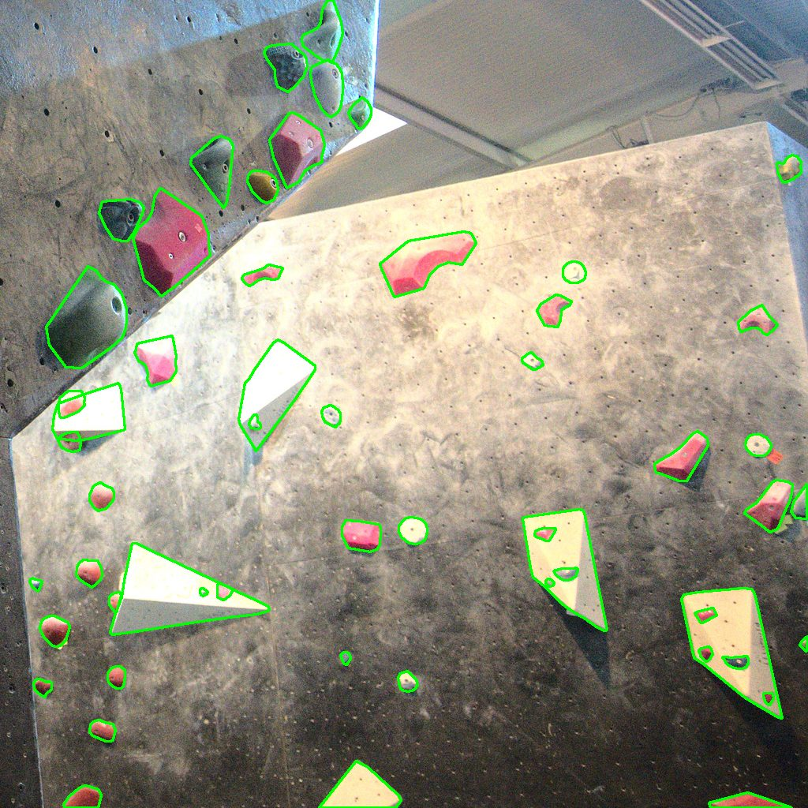
*Ground-truth hold + volume masks on a training crop — the labels the detector learns from.*

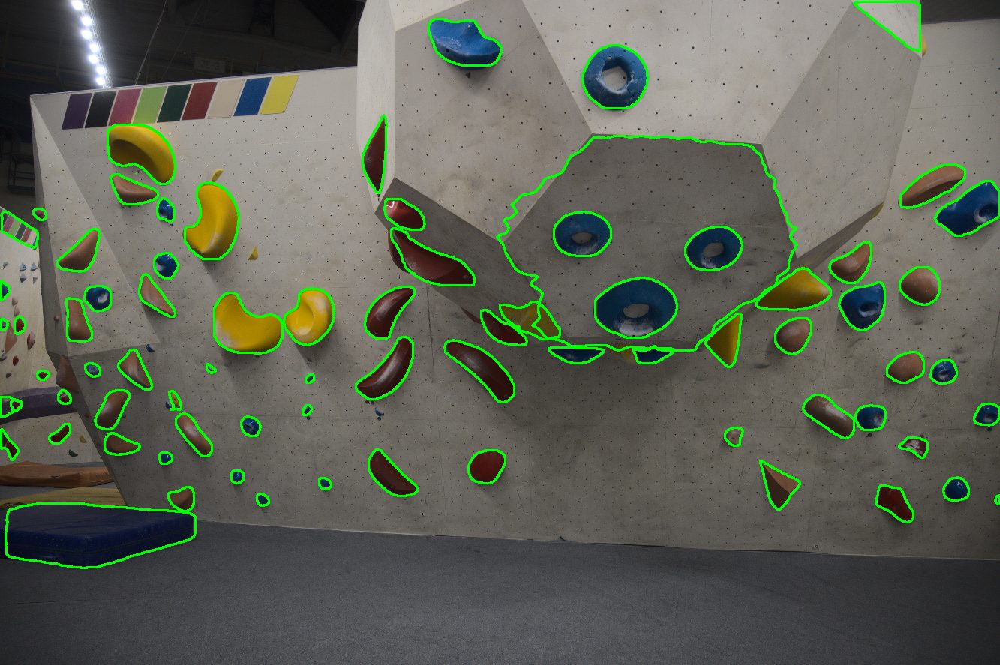
*Our Mac-trained Mask R-CNN predicting hold outlines on a gym it never trained on (mask AP50 84.0 after the 2026-10-20 label fix; originally reported as 29.4). Note the crash pad false-positive bottom-left.*

### M10 — Route grouping by color ✅ (per-route purity 0.78)
- `pipeline/routes.py`: per-hold dominant color in **CIELAB** — erode mask to avoid
  edge bleed, trim chalk (bright)/shadow (dark) by lightness, take median. Then
  **cluster each wall's holds by appearance** (agglomerative on weighted Lab) and
  **name each cluster by its centroid** (hue-angle-first match to a 12-color gym
  palette; achromatic → black/grey/white by lightness), merging same-named clusters
  into color-routes. Cluster-then-name beats per-hold naming and adapts to the gym.
- **Validation** (`scripts/evaluate_routes.py`, 8 bh images w/ `route_id`, 587 holds):
  **per-route color purity 0.78**, completeness 0.70, at ~4–7 colors/wall (sensible,
  not over-segmented). ARI vs `route_id` stays ~0.38 **by design** — gyms reuse
  colors across routes (e.g. 17 routes, ~8 colors), so color can't reproduce the
  finer `route_id`.
- **Honest take:** solid on clear colors; the remaining ~22% are genuinely hard
  (near-identical hues under dim light + chalk, off-color volumes in a route).
  **Further improvement paths:** per-gym palette calibration (several photos include
  a color swatch strip), a small learned classifier, or per-hold color labels.
  Pre-trained triplet net unused.

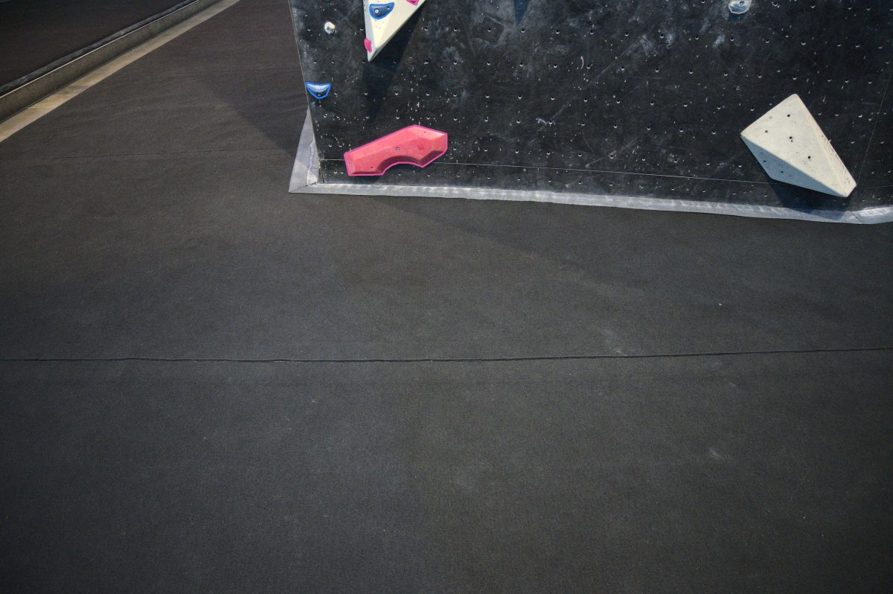
*Each hold outlined in its predicted route color — holds sharing a color form a route.*

### M11 — Hold depth dataset (Depth Anything 3) 🔧 CPU core done + validated
The stated Phase 2 goal. Split so only the DA3 inference needs a GPU; everything
else is built and validated on CPU now.

- **Geometry pipeline (`pipeline/depth.py`, CPU):** camera intrinsics from EXIF
  focal (or default), back-projection, RANSAC wall-plane fit, **gravity-aligned
  per-hold frame**, height map (vectorized scatter-max), normal map, point cloud
  (capped), summary (max/mean protrusion, footprint, volume, facing), and
  confidence scoring + flags. Record schema in `pipeline/depth_schema.py`;
  JSON + .npz serialization via `save_records`.
- **DA3 interface (`pipeline/depth_model.py`):** official API verified against the
  repo — `DepthAnything3(model_name="da3metric-large").inference(image=[...])`,
  metric = `focal_px * net_output / 300`. Lazy imports so it never needs torch/DA3
  locally.
- **Colab package (`backend/colab/`):** `da3_inference.py` + `README.md` — runs the
  one GPU step on a free Colab T4, writes per-image metric-depth `.npz` to download.
- **Local builder (`scripts/build_depth_records.py`):** stitches DA3 depth + holds
  (VIA GT now; M9 detector for unlabeled) + M10 colors → records per scan.
- **Validation:** `scripts/validate_depth_synthetic.py` — **14/14** on synthetic
  scenes with known answers (protrusion recovered to the mm, wall angles exact,
  footprints within tol, serialization round-trip). The full real-data stitch path
  was smoke-tested on all 15 bh images (1,487 holds) with a flat stand-in depth.
- **Chosen defaults for the doc's open specs (revisit):** height map 2.0 mm/cell;
  low-confidence flags at mask <800 px or wall-fit noise >12 mm; export = per-scan
  `records.json` + `arrays.npz`, versioned by model + pipeline version.
- **Remaining (needs GPU):** run `da3_inference.py` on Colab, drop the depth into
  `build_depth_records.py` → real protrusion records; then the T-nut-grid scale
  check + synthetic validation form the fieldwork-free validation report.

**RAN ON REAL DA3 DEPTH (2026-10-05).** DA3METRIC-LARGE was run on Colab over the 19
labeled images; `build_depth_records.py` produced **1,691 hold-depth records**
(`backend/artifacts/depth/<gym>-<stem>/`), with the DA3 depth maps persisted to
`backend/artifacts/da3_depth/`. Findings:
- **Footprints are physically plausible** — holds ~38 mm median width, volumes
  300–540 mm — so the metric *scale* is in a sensible range. Height-map viz:
  `backend/artifacts/depth/m11_heightmap_sample.png`.
- **Protrusions are under-estimated** (median ~5 mm vs real 20–100 mm). Expected
  limitation of **full-image** monocular depth: a hold is only a few pixels in DA3's
  504-px output, so its protrusion is within the wall's depth noise. The doc's
  **step 4 (per-hold crop DA3 at full res)** is the fix — a further GPU step.
- **Resolution fix applied:** DA3 outputs depth at a downscaled res, so the metric
  focal must match that res (not the original) — corrected in `build_depth_records`.
- **Scale is assumed:** these dataset images have no EXIF focal, so absolute scale
  uses the default focal and records are flagged `assumed_intrinsics`/`assumed_gravity`
  (mean confidence 0.47). Real app photos carry EXIF + gravity (M2 CaptureMeta),
  which will tighten this.

**Still to do for full M11 sign-off:** the T-nut-grid scale-validation report, and
running across the whole corpus (holds from the M9 detector for unlabeled images).

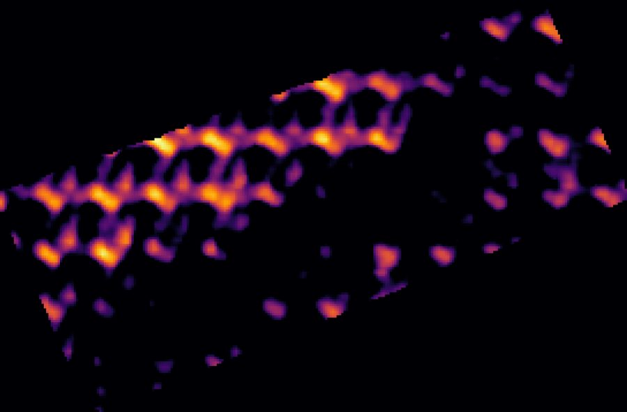
*One hold's front-surface height map (protrusion above the wall) from DA3 metric depth.*

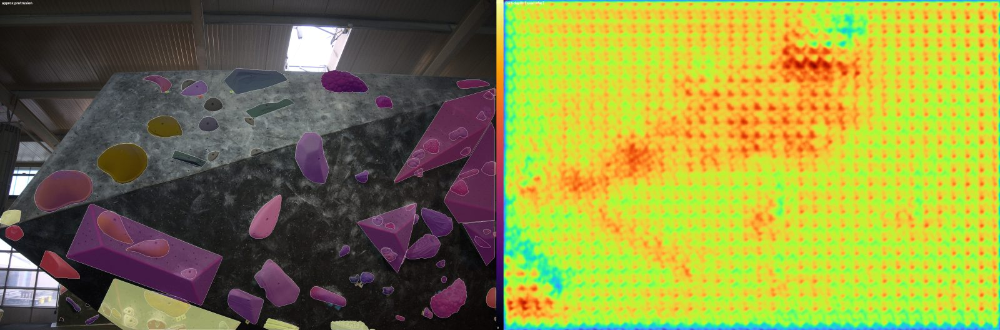
*Left: holds colored by approximate protrusion. Right: DA3's full-wall depth map (it even resolves the T-nut dot grid).*

### Graspability — per-hold depth → where to grab (2026-10-05)
Stanley's real goal is identifying **where a hand can grasp each hold**, which needs
per-hold *surface shape*, not just one protrusion number. Full-image DA3 was far too
coarse for that (see failures below), so a second model was bound in:

- **Per-hold high-res relief (`pipeline/hold_relief.py`):** run **Depth Anything V2
  Small** (via `transformers`, on **MPS** — no cloud GPU) on a padded full-res crop
  around each hold; fit the surrounding bare-wall ring to a plane in disparity and
  subtract → the hold's relief above the wall. This recovers real structure
  (slopers, incut lips, jug domes, volume facets) — a dramatic improvement over the
  few-pixel full-image depth.
- **Graspability (`pipeline/grasp.py`):** from the relief, score each pixel by
  relief height + edge strength (lips/rims) + a top-bias, gated to the solid part;
  output a grasp heatmap + best grasp point per hold.
- **End-to-end (`scripts/build_grasp.py`):** per hold → relief + grasp map + point,
  saved to `grasp.json` (grasp point in normalized image coords) + `grasp_arrays.npz`,
  plus a wall overlay marking where to grab every hold.
- **Results:** on bh/0075 (63 holds) and bh/0917 (85 holds), grasp points placed on
  62/63 and 85/85 holds, mostly on the graspable part. Panels + overlays in
  `backend/artifacts/grasp/` (`*_grasp_panels.png`, `*_wall_grasp.png`).

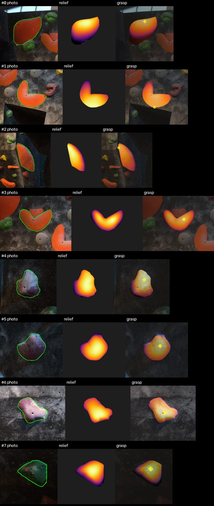
*Per hold: photo crop | high-res relief (Depth Anything V2) | grasp heatmap + best grasp point.*

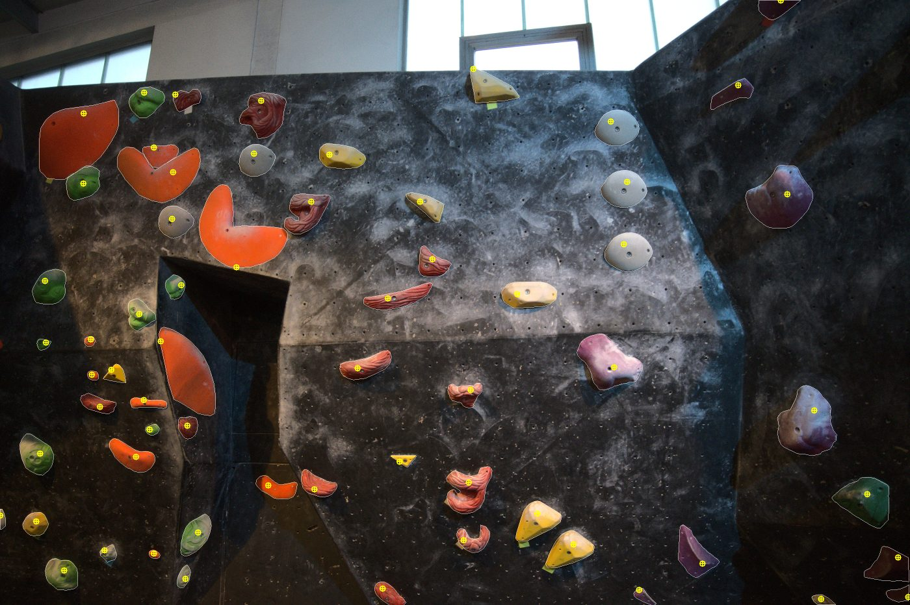
*The grasp point (where a hand can pull) marked on every hold across a whole wall.*
- **Honest limits:** DA V2 is relative (disparity), so relief is relative not metric —
  fine for *where* to grasp, but absolute mm needs fusing with DA3's metric scale.
  Grasp placement is a heuristic (no grasp ground truth); good on most holds, off on
  a few (e.g. crescents). Volumes (grab the edge, not a point) aren't modeled well.

### Fused metric + slope-aware depth (2026-10-05) — NEW, old pipeline kept
Two upgrades, in a **separate** pipeline so the relative one above stays for comparison:
- **`pipeline/fused_depth.py`:** anchor each hold's local wall distance from DA3's
  (near-flat but global) metric depth, map DA V2 disparity to metric via an
  inverse-depth model at that anchor (`Z = Z0 · v_wall / v`) → holds land at their
  real wall distance and share **one metric scale** (comparable, not self-normalized).
- **Slope awareness:** back-project each crop to 3D and fit the **local wall plane**
  from the surrounding ring, then measure protrusion **along that plane's normal** —
  correct even where the panel is angled/overhanging (not a flat-2D assumption).
- **`scripts/aggregate_depth_fused.py`:** whole-wall composite with one shared mm
  colorbar + prints local wall-tilt spread. Output `*_wall_depth_fused.png`
  (compare to the relative `*_wall_depth.png`).
- **Results:** per-hold max protrusion p10/50/90 ≈ **3/25–31/150–186 mm** (realistic:
  crimps mm, jugs ~3 cm, volumes ~15–19 cm) — a big improvement over the old ~5 mm.
  Local wall tilt spread ~60–84° across holds (large because walls are overhung and
  shot from below; the spread confirms slope is non-uniform and being measured).
- **Limits:** DA V2's affine *shift* is ignored (inverse-depth approximation), so
  absolute mm are approximate; the local plane normal is noisy (DA V2 noise), so tilt
  is camera-relative and rough — true overhang angle needs the gravity vector (M2
  CaptureMeta, present in real app photos but not these dataset images).

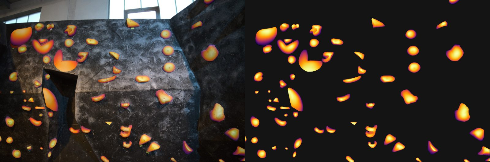
*OLD relative aggregate: each hold self-normalized, so all holds look equally deep.*

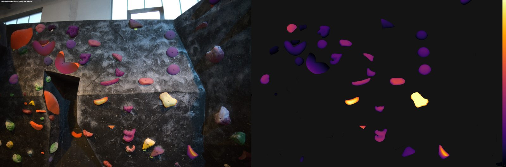
*NEW fused: shared metric scale + protrusion measured along the local wall normal — only genuinely deep jugs/volumes glow bright.*

---

### Wall angles from a surface-normal model (2026-10-05)
Question: can a model get the *wall's* angles (not just per-hold relief) from one photo?
Answer: yes — a dedicated **surface-normal model** is the right tool (cleaner than
differentiating depth).
- **`pipeline/wall_normals.py`:** **Marigold Normals** (diffusers, MPS, ~5 s/image)
  → per-pixel surface normals. The big wall panels come out clean and separable
  (main face vs overhang vs side panels), unlike depth-derived normals.
- **`scripts/eval_wall_angles.py`:** segment the bare wall by normal (KMeans) into
  panels; report each panel's **angle vs the main face** (gravity-free, robust) and a
  rough absolute **angle vs vertical** using a *simulated* gravity.
- **Results:** bh/0075 → main overhang face + **side panels 25–27° off** it (the
  arete/corner), ~9° internal curve; bh/0917 → essentially one big overhanging face.
  Eval images: `backend/artifacts/grasp/{0075,0917}_wall_angles.png` (panel overlay +
  normal map) and `0917_normals_probe.png`.
- **User effort:** none — single photo, and in the real app the **gravity vector is
  captured automatically at the shutter (M2)**, which turns the relative angles into
  true angle-vs-vertical. (Dataset images lack gravity, so absolute angles here are
  simulated/rough; relative inter-panel angles are already meaningful.)
- **Limits:** segmentation has some bleed; absolute angle needs real gravity; Marigold
  is diffusion (~5 s) — fine for one photo. Multi-view/LiDAR would be more precise but
  cost user effort.

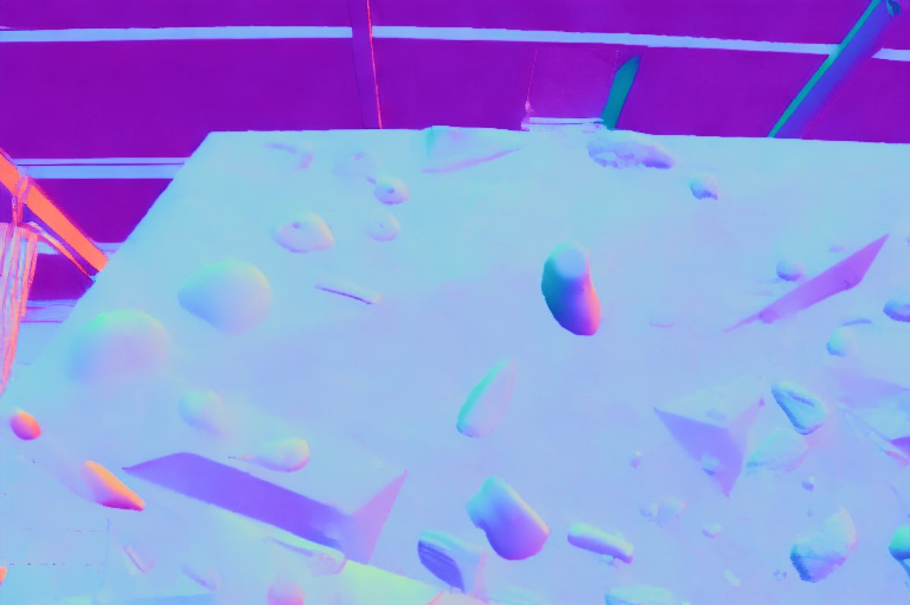
*Marigold per-pixel surface normals: the main face (cyan) and overhang panel (purple) come out as distinct, uniform regions — directly separable by orientation.*

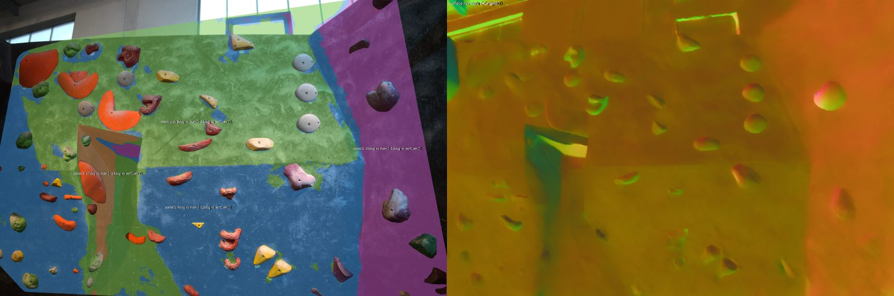
*Bare wall segmented by normal into panels; side panels read 25–27° off the main face (single photo).*

## What was tried that didn't work (and why)

- **Full-image DA3 for per-hold protrusion → failed.** DA3METRIC outputs depth at a
  downscaled ~504 px; a hold is only a few pixels there, so its protrusion (median
  ~5 mm recovered vs real 20–100 mm) is lost in the wall's depth noise. *Fix:* run a
  depth model on per-hold full-res crops instead (Depth Anything V2 on MPS).
- **Depth/focal resolution mismatch → wrong scale.** First records came out ~7 m with
  a flat 0.3 m range because the metric focal was computed from the *original* image
  size while DA3's depth is downscaled. Per the DA3 card, focal must match the depth
  output resolution. *Fix:* correct the metric by the depth/orig long-side ratio in
  `build_depth_records.py`.
- **DA3METRIC returns no intrinsics.** The README example reads `pred.intrinsics`, but
  da3metric-large is monocular with no camera head (`cam_enc=None`), so intrinsics
  were absent and code fell back to EXIF/default focal. Dataset images have no EXIF →
  absolute scale is assumed and records are flagged low-confidence. Not a bug, a
  model limitation; real app photos carry EXIF + gravity (M2).
- **Grasp heuristic v1 (relief peak) → landed on the bump, not the lip.** Picking the
  global relief max put grasp points at the center of domes rather than the top edge
  you actually pull on. *Fix (v2):* gate out faint relief (`solid` band) + stronger
  top-bias + edge term, so points move to the graspable top rim. Still imperfect on
  crescents and volumes.
- **DA3 Colab install friction (all resolved, documented for next time):**
  (1) `requires-python <=3.13` rejected Colab's 3.13.x → `--ignore-requires-python`;
  (2) wrong import `from depth_anything_3 import DepthAnything3` → correct is
  `from depth_anything_3.api import DepthAnything3` + `.from_pretrained(...)`;
  (3) under-declared deps → `pip install addict omegaconf einops timm safetensors
  huggingface_hub`; (4) numpy downgraded to <2 (noisy conflict warnings with unused
  libs) — harmless for this workflow.
- **Absolute metric from a single relative model — not solved.** DA V2 disparity is
  affine-invariant; with only one anchor (wall distance) you can't recover true mm.
  Left relative for graspability; metric fusion with DA3 is future work.
- **Single-view normals under-capture subtle wall folds.** On a wall that physically
  folds top/bottom (bottom sloping up, top sloping down), Marigold returns **nearly
  the same normal for both halves** (~0.6–5° apart) — it reads the wall as one smooth
  orientation. The patchy clustering was just per-pixel noise (fixed with normal
  smoothing + median-filtered labels); the deeper limit is the model's weak
  sensitivity to gentle large-scale folds in a single photo. Adding a spatial term to
  the clustering produces a *clean-looking but geometrically arbitrary* split (it cuts
  by position, not real angle), so it's cosmetic — left off by default (`--spatial 0`).
  **Reliable fold geometry needs stronger 3D cues:** multi-view (a short video/photo
  pan → SfM/DA3-multiview) or iPhone LiDAR. Clearly-different panels (e.g. a 25–27°
  arete) *are* captured single-view; subtle folds are not.

## Key decisions log
- **Design system palette hand-tuned** (M0) — skill output conflicted with the
  overlay-readability brief.
- **Backend lives in the parent repo** (`backend/`), not the Expo app — co-located
  with data + models.
- **Crossed the Phase 1→2 hard gate** on 2026-10-04 per Stanley's instruction.
- **Compute:** M9 trained locally on MPS (own model) to avoid Detectron2/GPU pain;
  M10 is mostly classical (color clustering); **M11 (DA3 depth) still wants a GPU**
  and DA3 is used, not trained.

### M12 prototype — personalized beta / path planner (2026-10-13)
The product's core feature: holds → the hand/foot sequence up a route, personalized to
the climber. Built on the established approach (1SS28/climbing-beta, Climb-5): a climb
is **graph search over reachable holds** under the climber's reach.
- **`pipeline/beta.py`:** `Reach.from_body(height, wingspan)` sets reach limits; a
  **Dijkstra hand-path** over holds within one hand-move (biased upward, weighted by
  distance + graspability), then feet assigned beneath each stance. Outputs ordered
  `Step(order, hold_id, limb)` — the app's PathStep shape.
- **`scripts/plan_beta.py`:** loads a real route by VIA `route_id`, scales image coords
  to meters, plans, and draws the numbered hand/foot beta (circle=hand, square=foot).
- **Result (bh/0075 route 1, 12 holds):** short climber (160 cm) → **8 hand moves**;
  tall climber (190 cm) → **6** (skips holds the shorter climber must bridge). Same
  route, different beta = personalization working. Viz
  `backend/artifacts/beta/0075_route1_beta.png`.
- **Prototype limits:** scale is assumed (image height ≈ 4.5 m) — the real app uses the
  **multi-view metric reconstruction** for true positions + wall angle; foot assignment
  is nearest-lower (no center-of-mass/balance model yet, which the full approaches add);
  graspability defaulted unless `--grasp`. Next: feed real 3D hold positions + wall
  angle from the reconstruction, and add a balance constraint.
- **References:** [1SS28/climbing-beta](https://github.com/1SS28/climbing-beta),
  [ryanzhao2/Climb-5](https://github.com/ryanzhao2/climb-5).

### M12 v2 — real geometry + balance model (2026-10-13)

**Thought process (why these choices):**
1. *Which geometry source?* The multi-view DUSt3R cloud is accurate but was built on the
   **0310 wall, which has no route labels**; the route-labeled images (0075, 0917…) are
   different walls. Forcing a correspondence would be fragile. Instead I used the **DA3
   per-hold metric depth already computed for the labeled image itself** — back-project
   each route hold's mask to a 3D point (`pipeline/geom3d.py`). Same image → no
   correspondence problem, and it still carries real depth/overhang.
2. *Scale problem.* Feeding **pure DA3 3D** into the planner collapsed it — both climbers
   finished in 3 moves, personalization gone. Cause: DA3's **absolute** metric scale is
   unreliable on these EXIF-less shots (documented earlier: protrusions under-resolved,
   wall "distance" ~1.26 m), so hold-to-hold distances in meters came out tiny vs the
   ~1 m reach. *Fix (hybrid):* take **x,y from the image** (stable scale via assumed wall
   height, which personalizes well) and use **DA3 depth only as a RELATIVE z** —
   median-centered and normalized so its spread ≈ 0.3 m. This keeps the good scale while
   adding true overhang-awareness (3D reach distance now grows for holds set deeper /
   more overhung). The real app replaces this with the multi-view **metric** reconstruction
   + captured gravity for fully-correct scale and true vertical.
3. *Balance model (barn-door).* A move can be reachable yet unstable — if every contact is
   on one side of the body's vertical line, the climber swings off ("barn door").
   `stance_stability()` scores a 4-limb stance 0..1 by: COM centered within the lateral
   span of contacts (0.5), both sides straddled (0.3), wide base (0.2), with COM shifted
   slightly below the grips (hips). Integration: (a) the hand-path search now penalizes
   big **lateral** jumps (barn-door risk), and (b) after each hand move the opposite-side
   **foot is re-seated to maximize stability** (`_best_foot`). Output now includes a
   per-move stability so the UI could warn on dicey stances.

**Result (bh/0075 route 1):** short (160 cm) → 8 hand moves; tall (190 cm) → 6; **mean
stance balance ~0.80** (feet actively straddle the COM). Viz
`backend/artifacts/beta/0075_route1_beta.png` — hand path + stability-placed feet, per climber.

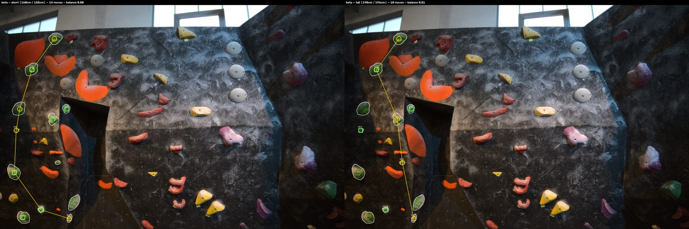
*Same route, two climbers. Yellow = hand sequence (circles), green squares = feet. Short climber (left) needs 8 hand moves; tall (right) does it in 6 — personalization + balance-placed feet.*

**Honest limits:** absolute scale still assumed (hybrid) until multi-view metric is wired
in; the balance model is a lateral barn-door heuristic (no full torque/CoM-over-feet
dynamics, no handedness of pulls); feet re-seat one side per move. Good enough to show
reach- and balance-aware personalized beta; the real planner would use metric 3D + gravity
and a fuller stability model.

### Frontend — scan mode choice (quick vs precise multi-view) + web debugging (2026-10-13)
- **Scan mode (app, `rc/`):** Home "Scan wall" → `scan/mode.tsx` offering **Quick scan**
  (1 photo, instant) or **Precise scan · beta** (**3–5 photos**, capped — more is too
  much to capture → 3D reconstruction). Camera does guided multi-capture in precise
  mode (count pill `N / 5`, Done after ≥3, shutter disables at 5);
  preview shows a thumbnail strip; `createScan` contract extended to arrays
  (`images[]`, `metas[]`, `mode`) — the seam the Phase 2 multi-view backend swaps into.
  The mock logs mode + view count and takes longer for precise. tsc + lint + iOS
  bundle clean. (Decision: multi-photo, not video — Expo-Go-friendly + how DUSt3R
  consumes views.)
- **Web debugging:** two fixes so the app runs in a browser —
  (1) `app.json` web output `static` → **`single`** (SPA, client-rendered); and
  (2) `fixtures.ts` used `Image.resolveAssetSource`, which **doesn't exist in
  react-native-web** → replaced with the cross-platform `Asset.fromModule(mod).uri`
  (expo-asset). Verified via headless Chrome: the app mounts and renders the
  onboarding screen (no error boundary). Run with `cd rc && npx expo start --web`.
  Camera/sensors don't work on web (expected), but all fixture-driven screens
  (onboarding, auth, home, results, path, beta, profile, saved) are fully debuggable.

### Multi-view batch results (2026-10-13)
Ran the batch Colab notebook on `wall_sets_batch.zip` → all 4 verified walls
reconstructed (~0.5–0.8 M points each). Fold angles (two-plane fit):
**wall_0035 = 73°** (deep cave/overhang — matches the photo), **wall_0148 = 21°**
(corner), wall_0032 / wall_0190 read ~one dominant plane (clear tilt in X-Z but the
second plane stayed < 10% of points). Comparison figure
`backend/multiview/batch_walls_compare.png` (ref photo + top-down 3D per wall);
clouds/profiles in `out.zip`. Confirms the pipeline generalizes across walls from the
dataset's existing multi-view — no new capture.

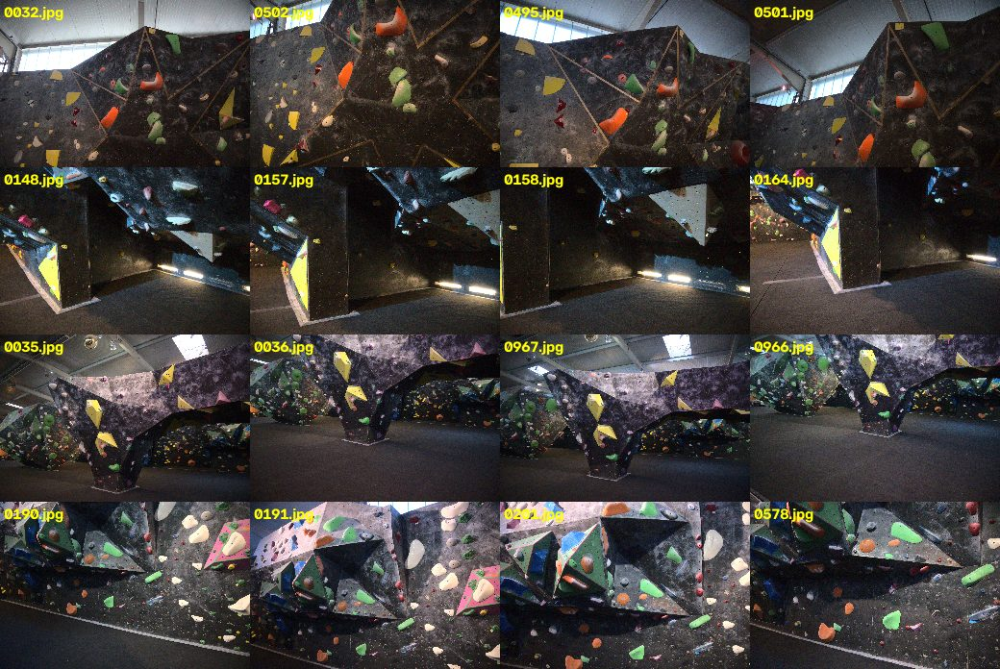
*Each row = one wall from multiple angles (ORB + fundamental-matrix verified), ready for 3D reconstruction.*

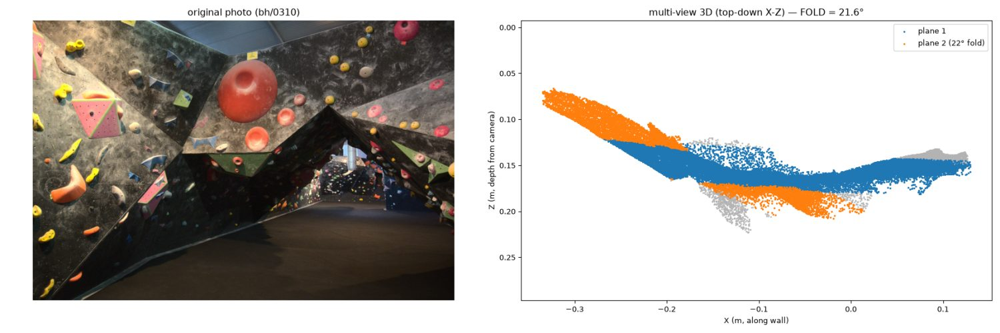
*The red-dome/fold wall: left = original photo, right = DUSt3R top-down 3D. The 21.6° fold single-view normals missed is explicit in the reconstruction.*

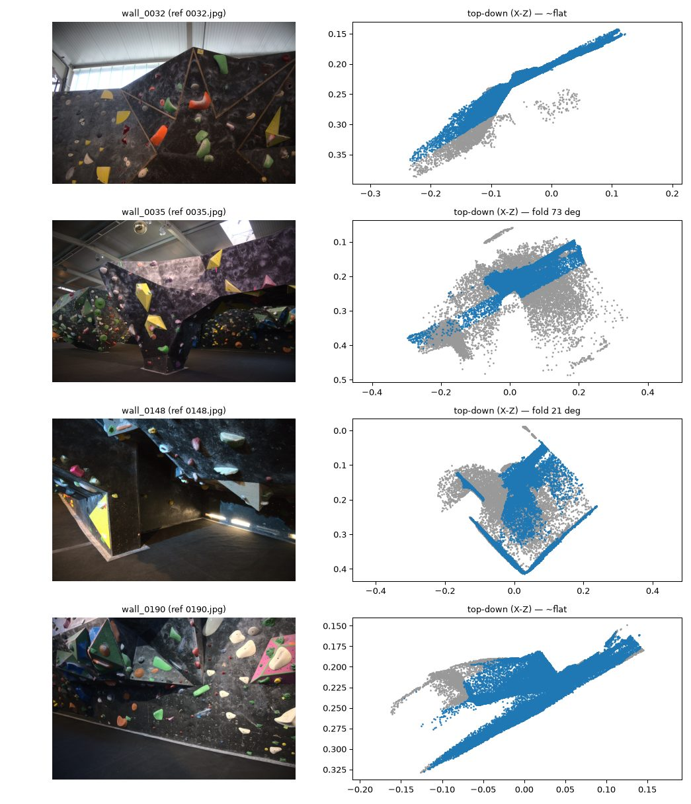
*Batch reconstruction: reference photo + top-down 3D per wall (wall_0035 = 73° cave, wall_0148 = 21° corner).*

### Fold detector v2 + metric scale from hold size (2026-10-14, backend only)
**Fold detector — fixed.** The old two-*position*-plane RANSAC mislabelled gradual
prows as "flat" (the 2nd face was < 10% of points). New `analyze_folds.py` clusters
per-point **surface normals** to *assign* points to two faces (robust to lopsided
counts), then fits a real plane to each face and measures the **dihedral angle**;
the crease direction says prow (vertical) vs cave (horizontal). Re-ran the 5 clouds:
wall_0032 **13°** prow, wall_0190 **16°** prow (both were "flat" before), wall_0148
**37°** corner, wall_0035 **85°** cave, wall_0310 **19°** prow. **Validation:** 0310
independently measured 21.6° earlier (two clean planes) → 19° here = consistent, and
every orientation matches the photo. *Trust the shapes and now the angles (±few°).*

**Metric scale from average hold size (`scripts/scale_from_holds.py`).** A monocular
reconstruction is only correct up to a global scale; one known real length fixes it.
We measure each hold's longest dimension in model units (median, volumes excluded),
divide by an **assumed average real hold size**, and scale everything. On bh/0075:
measured median hold = 64 mm (DA3 units); assuming a 14 cm real hold → **scale 2.17×**
→ route vertical span **1.98 m** (realistic) and personalization returns (short 5 vs
tall 4 hand moves). Sensitivity: assumed 10 cm → 1.55× (span 1.4 m, no personalization);
18 cm → 2.8× (span 2.5 m, 6 vs 5). **Honest take:** the anchor is principled and
tunable but only as good as (a) the assumed average and (b) the underlying geometry's
consistency — DA3 single-image depth is somewhat compressed, so the anchor is **best
applied to the multi-view cloud** (consistent 3D) for a fully reliable metric scale.
Replaces the beta planner's assumed-wall-height guess. **No frontend changed.**

**Combined on the multi-view cloud (`compare_geometry.py`).** Ran fold + hold-size
anchor together on wall_0310: detect colored holds → median 140 mm (anchored to a 14 cm
assumption) → **scale 7.26×** → wall **~3.4 m wide × 1.6 m deep-ish**, **fold 18°**.
Two independent cross-checks line up: the 18° matches the 21.6° / 19° fold measurements,
and the 7.26× scale matches the earlier rough "if ~3.5 m wide then ~7.5×" estimate — so
on a *consistent* multi-view cloud the hold-size anchor gives reliable metric geometry.

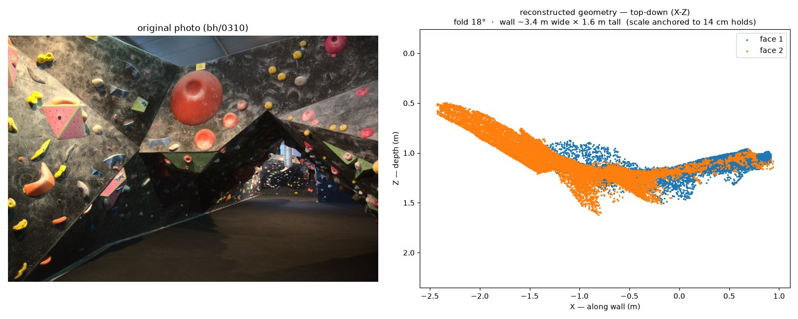
*Left: the wall photo. Right: top-down reconstruction — two faces (orange/blue) folding at 18°, axes in real meters (scale anchored to average hold size). The bend single-view missed is explicit and now metric.*

## Opportunity: the dataset already has multi-view of the same walls
The `bh` set (1,061 images) is a **walk-around of the gym** — the same walls shot from
many angles (e.g. `bh/0310.jpg` and `bh/0526.jpg` are the same wall: red dome + pink
triangle volume). A color-hist check found every one of the first 200 images has a
>0.9 twin. **This means multi-view 3D reconstruction is possible on existing data (no
new capture)** — the reliable fix for wall folds/angles that single-view normals miss.
Candidate tools: DUSt3R/MASt3R (learned pairwise 3D, runs locally), VGGT, or COLMAP.
Next step if pursued: auto-group images by wall, run pairwise 3D, fit planes → true
fold angles. Confirmed single-view normals cannot resolve the subtle diagonal fold
(it's at the noise floor); clearly-different panels still work single-view.

**DUSt3R set up in `backend/multiview/`** (cloned repo + `run_dust3r.py`: reconstructs
3D from same-wall views, fits 2 wall planes, prints the fold angle, saves a point
cloud + X-Z profile). **The method works** — on `bh/0310`+`bh/0526` the DUSt3R
inference + global alignment ran and *converged* (loss ~0.0002, fast). **But it won't
run reliably on this Mac:** the 2.3 GB model intermittently gets SIGKILL (OOM) at load
or point-extraction even with ~50 % RAM free (borderline/fragmented). So the GPU step
moved to **Colab** (`backend/multiview/dust3r_colab.ipynb`) — same pattern as DA3.
Upload `run_dust3r.py` + a zip of same-wall views, run on a GPU, get the fold angle +
`wall_profile.png` + `wall_cloud.ply`.

## Open items / blockers
- On-device Expo Go pass for Phase 1 (yours to run).
- Replace placeholder fixture wall photos with real gym photos before M3 feels real.
- **M11 needs a GPU** for Depth Anything 3 at reasonable speed.

## Changelog
- **2026-10-04** — Closed M2 v4 CaptureMeta gap; crossed Phase 1→2 gate; built +
  validated M7 and M8; trained + evaluated M9 (own Mask R-CNN on MPS, AP50 29.4 /
  IoU 0.87); built + tuned M10 color grouping (cluster-then-name, per-route purity
  0.78); created this log.
- **2026-10-05** — Built the M11 CPU core (geometry pipeline + record schema +
  serialization), verified DA3's real API, packaged the GPU step for Colab, and
  wrote the local record builder. Synthetic geometry validation 14/14.
- **2026-10-05 (later)** — Ran DA3METRIC-LARGE on Colab; built **1,691 real
  hold-depth records** over the 19 labeled images. Footprints plausible; protrusion
  under-resolved by full-image depth (needs per-hold crops, step 4). Fixed a
  depth/focal resolution mismatch. Dataset + depth maps persisted under
  `backend/artifacts/`.
- **2026-10-05 (grasp)** — Pivoted to the real goal (where to grab). Bound a second
  model: **Depth Anything V2 on per-hold full-res crops (MPS)** for rich relief, then
  a graspability map + grasp point per hold. Wall overlays for bh/0075 (63 holds) and
  bh/0917 (85). Documented failures (full-image depth, focal/resolution, grasp v1) in
  "What was tried that didn't work".
- **2026-10-05 (aggregate)** — `scripts/aggregate_depth.py`: composite every hold's
  relief back onto the full image → one wall-wide depth heatmap (`*_wall_depth.png`,
  photo-overlay + pure heatmap). Holds self-normalized (DA V2 disparity isn't
  cross-crop comparable).
- **2026-10-05 (fused + slope)** — `pipeline/fused_depth.py` + `aggregate_depth_fused.py`:
  anchor DA V2 relief to DA3 metric per hold (comparable mm across holds) and measure
  protrusion along the **local 3D wall normal** (slope-aware). Output
  `*_wall_depth_fused.png`; old relative pipeline kept for comparison. Protrusions
  now realistic (p50 ~25–31 mm).
- **2026-10-05 (wall angles)** — `pipeline/wall_normals.py` + `eval_wall_angles.py`:
  single-photo **Marigold surface normals** (MPS) → wall-panel segmentation + angles.
  bh/0075 shows side panels 25–27° off the main face. Needs only one photo; real app's
  gravity (M2) makes absolute angles true. Eval imgs `*_wall_angles.png`.
- **2026-10-05 (fold investigation)** — Added normal smoothing + median label cleanup
  (fixes patchy segmentation) + optional spatial clustering term. Finding: single-view
  normals **under-capture subtle top/bottom wall folds** (both halves ~same normal);
  clearly-different panels are fine, gentle folds need multi-view/LiDAR. Documented in
  "What was tried that didn't work".
- **2026-10-05 (multi-view)** — Confirmed the dataset has multiple views of each wall
  (bh is a gym walk-around; 0310≈0526). Set up DUSt3R in `backend/multiview/`
  (`run_dust3r.py`): reconstruction + global alignment **works and converges**, but the
  2.3 GB model OOM-kills intermittently on this Mac → moved the GPU run to Colab
  (`dust3r_colab.ipynb`). This is the path to real fold geometry.
- **2026-10-05 (multi-view run)** — On Colab GPU the full pipeline ran: 7 same-wall
  views → **722,533 3D points**, alignment loss 0.0059, consistent focals (~320–395 px).
  Bundled a one-upload set `wall_0310_set.zip` (feature-matched + geometry-verified
  same-wall views + script). Fixed a plane-fit hang (`np.linalg.svd` needed
  `full_matrices=False` + subsampling on ~400k points).
- **2026-10-13 (multi-view result)** — Reconstruction of the red-dome/fold wall gives a
  **21.6° fold** between the two wall planes (plane1 normal ≈ (0.06,−0.04,−1.00);
  plane2 ≈ (0.39,0.11,−0.91)). Side-by-side `backend/multiview/fold_vs_original.png`
  clearly shows the bend single-view normals missed (they read ~0.6°). **Multi-view is
  the reliable path to wall geometry.**
- **2026-10-13 (batch walls)** — Grouped all 1,061 bh images into same-wall sets:
  ResNet18 embeddings (MPS, 63 s) over-merge (cluster by "looks like a wall"), so added
  **ORB + fundamental-matrix geometric verification** → 4 clean verified walls
  (`backend/multiview/sets/`, montage `verified_sets_montage.png`). Bundled
  `wall_sets_batch.zip`; the Colab notebook now **loops over every wall** (prints each
  fold angle, downloads one `out.zip`). Run it to get geometry for all 4 at once.
- **2026-10-20 (audit + detection fix)** — Audited every stage honestly and wrote
  **`IMPROVEMENT_PLAN.md`** (phased roadmap, data sources, keys needed, Google Maps gym
  detection). While benchmarking against the unused pre-trained Detectron2 model
  (`data/model/model_final.pth`, converted into torchvision by
  `pipeline.holds.build_detectron2_model`; `evaluate_holds.py --detectron2`), found that
  **both** models scored exactly 0 on `bh-phone`: its VIA polygons were drawn on a
  half-size copy of each photo. Fixed via `ANNOTATION_SCALE` in `load_via_index`.
  Corrected cross-gym mask AP50: **ours 84.0 / IoU 0.884; Detectron2 85.9 / IoU 0.860**
  — effectively tied, so ours stays. Test set is only 4 images / 201 holds; enlarging it
  is Phase 1 step 1. Rebuilt the 2 `bh-phone` depth records with the corrected masks.
  (Training used `bh` only, so the trained model was unaffected.)
- **2026-10-20 (backend connected — IMPROVEMENT_PLAN 0c, local)** — `backend/server/app.py`
  (FastAPI) implements the app's `CapitanApi` over HTTP; `pipeline/scan.py` runs
  detection (M9, score ≥ 0.5, up to 400 holds) → color routes (M10) per scan, and the beta
  planner (M12) per path request with metric scale from median hold size (14 cm assumed,
  clamped to a 2–10 m wall). Places use `PlaceRegistry` (seeded with the fixture gym names,
  no coords). Every upload + CaptureMeta, hold correction, path correction and grade is
  persisted under `backend/store/` (jsonl logs = training labels). App: `src/api/http.ts`,
  `API_MODE` now defaults to `http`; auth/profile stay on the client mock. Verified: every
  endpoint via TestClient on bh/0075 (65 holds, 6 routes; 160 cm → 8 steps, 190 cm → 6),
  and in the app on web — bh/0917 scan → results with real outlines → path view with
  numbered moves. ~1.2 s per scan on MPS after model load. **Not yet verified on a phone**
  (React Native multipart upload path). Visible weakness on 0917: wall-panel edges and
  shadows detected as holds (Phase 1 hard negatives).
- **2026-10-20 (upload a photo)** — Camera screen gains a photo-library button left of the
  shutter (quick: 1 photo → preview; precise: fills the remaining views), plus "Upload a
  photo" on the camera-permission screen so the app works without a camera (incl. web).
  `src/lib/pick-photos.ts` (expo-image-picker) keeps EXIF focal length; no gravity for
  uploads (CaptureMeta allows that). Also stopped the web-only DeviceMotion subscribe error
  from surfacing as a dev overlay. Verified on web: upload → preview → gym search → quality
  → server scan (80 holds, 7 routes, 1.5 s) → results. Library button beside the live
  camera not yet seen on a phone.
- **2026-10-20 (pipeline evaluation + improvements)** — New `scripts/evaluate_pipeline.py`
  scores every stage on a held-out split with the server's own code
  (`backend/eval/baseline_test.json` → `metrics_test.json`). Split rule in
  `pipeline/splits.py` (sm + bh-phone held out; other gyms hashed 75/25 — new images
  are assigned automatically). Route-color ground truth hand-labeled for all 69
  routes (`backend/eval/route_colors.json`) because the old purity/completeness metric
  is maximized by merging everything into one color — the real baseline color accuracy
  was **0.375**, not "0.78 purity". All choices made by leave-one-image-out on train;
  test reported once.

  | Stage (test split) | Baseline | Now |
  |---|---|---|
  | Detection AP50, unseen gym sm / bh-phone | 76.7 / 96.8 | **81.1 / 98.4** |
  | Detection recall @0.5, sm (small holds) | 0.73 (0.53) | **0.80 (0.65)** |
  | Detection strict mask AP (all test) | 67.9 | 64.0 (outlines slightly looser) |
  | Route color accuracy (labeled holds) | 0.375 | **0.625** |
  | Hold color accuracy | 0.36 | **0.52** |
  | Planner reaches top of route | 0.62 | **0.73** |
  | Taller climber never needs more moves | 0.80 | **0.90** |
  | Stance balance / feet per hand move | 0.61 / 0.43 | **0.82 / 0.81** |
  | End-to-end route IoU / routes recovered | 0.27 / 0.13 | **0.36 / 0.17** |

  Changes: (1) detector training samples crops at the app's working scale
  (0.7–2× of the 1333-px inference size — old training saw holds ~1.8× larger than at
  inference) + lighting jitter + 6 crops/image/epoch, split-aware, all gyms;
  (2) colors named by k-NN over labeled holds in an exposure-normalized,
  lightness-relative chroma space (`ColorNamer`; LOO route accuracy 0.80 vs 0.41 palette);
  wall-based white balance and in-photo cluster voting were tried and *hurt* in LOO;
  (3) same-color routes split by 1.2 m reach linkage (one route per color merged
  separate climbs); merging small fragments was tried and hurt; (4) planner: start from
  any hold reachable while standing on the lowest hold, traverses (≤0.4 m down), a
  fixed per-move effort cost, best partial path when the top is out of reach.
  App model retrained on all data (`m9_maskrcnn.pt`; v1 kept as `m9_maskrcnn_v1.pt`);
  color refs rebuilt from all labels. **Biggest remaining gap: colors on unseen walls
  (0.53 of found holds) — more labeled routes feed the k-NN directly.** Planner
  metrics are sanity checks only — no ground-truth beta exists yet; its moves
  (~2–3 per route) look long vs. real climbing, reach model unvalidated.
- **2026-10-20 (hold quality + wall angle connected)** — New analysis phase
  (`pipeline/analysis.py`, `scan.analyze_scan`) runs right after detection on the
  server, so results show first and this fills in ~7–17 s later (`Scan.analysis`
  pending → done). Per hold: **quality** 0–1 (heuristic: size in cm + prominence =
  per-hold Depth Anything V2 relief vs the bare wall's depth noise; volumes neutral 0.5),
  **gripPoint** (existing `grasp.py`), **wallAngleDeg** (Marigold normals on the wall
  around the hold; absolute only with CaptureMeta gravity, + overhang / − slab) and
  **relWallAngleDeg** (vs the main wall, always). Scan-level `wall` summary. Quality
  feeds the planner's existing hold-quality input (was a constant 0.6); the planner's
  logic is unchanged (wall angle not used yet, by request). Optional fields added to
  `rc/src/api/types.ts`; no UI shows them yet. Verified: endpoints via TestClient,
  stored scans analyzed on restart, app results/path flow; evaluate_pipeline metrics
  unchanged. **Not validated:** quality has no ground truth; absolute wall angles need
  a real phone photo (dataset/uploads have no gravity) — sign convention checked
  against Marigold docs (x right, y up, z toward camera) and with simulated tilt.
- **2026-10-21 (Mosaic gym colors + tap-to-pick routes)** — 14 bright Mosaic-gym photos
  (`data/mosaic/m00–m13`, from `Mosaic_walls/` + the user's upload) labeled for hold
  color: detector outlines → per-photo look-alike clusters → each clean cluster named
  by eye, mixed ones skipped → **1,102 labeled holds** in `backend/eval/hold_colors.json`
  (all detections listed; `color: null` = unlabeled, still used for exposure). k-NN color
  references now include them (`ColorNamer.from_hold_labels`). Held-out Mosaic photos
  (m06, m10; 132 holds): hold color accuracy **0.841 → 0.955**; bh test route colors
  unchanged (0.625), bh hold colors 0.515 → 0.54, end-to-end route IoU 0.355 → 0.429.
  Caveats: test photos are the same gym (learning a gym from its own labels, not unseen-gym
  generalization), and clean clusters are the easier holds, so 0.955 is optimistic.
  **Tap-to-pick routes:** `scan.suggest_route` (same color, chained ≤1.2 m, within 0.6 m
  below / 1.25 m beside the start — limits chosen on train, flat in 0.49–0.53 IoU);
  endpoints `POST /scans/{id}/routes/suggest` and `POST /scans/{id}/routes` (custom routes
  kept through corrections, logged to `custom_routes.jsonl` = labeled route data); app
  screen `scan/pick-route.tsx` (entry "Tap to pick" on results). Test split: one-tap route
  IoU 0.388, 42% ≥ 0.5 — a starting point the climber edits, not a big accuracy gain.
  Verified in the web app: tap start → 7-hold suggestion → remove → save → path.
- **2026-10-21 (Claude as beta judge — experiment)** — Planner cost is now explicit
  features × weights (`beta.FEATURES`: move, dist, strain, bad_hold, down, lateral;
  hand-set `DEFAULT_WEIGHTS` unchanged, results identical). `pipeline/claude_judge.py`
  renders two candidate betas side by side and asks Claude Opus 5.5 (structured JSON,
  server-side fallbacks) which one a climber of that size would use;
  `scripts/judge_paths.py` makes candidates by perturbing the weights on labeled routes,
  logs every judgment to `backend/eval/claude_judgments.jsonl`, and fits weights by
  Bradley-Terry (λ by 5-fold CV over routes). Results (250 judgments, ~$5):
  - **Claude is consistent:** same path in both A/B orders on 88% / 79% / 85% of pairs
    (consistency / train / test runs); no position bias (A picked 48%); no refusals.
  - **Clear preference:** when paths differ in move count, Claude picks the one with
    **more, shorter moves 79%** of the time (42 pairs) — the planner's moves are too long.
  - **Learned weights don't beat hand-set on held-out pairs:** test agreement 0.725 vs
    0.725 (40 judgments); CV 0.66. Six path-total features can't express what Claude
    judges (body position, hold types). **Weights not saved** — the planner keeps the
    hand-set ones (`planner_weights.json` would switch it automatically).
  **Reach test (held-out test routes, 108 calls, ~$1.80):** current hand reach 0.62 ×
  wingspan vs 0.55 and 0.45 (`judge_paths.py reach`, `beta.HAND_REACH_FRAC`), judged where
  the paths differ:

  | Reach | Paths differ | Claude prefers shorter | Consistent pairs (shorter / current) | Reaches top (current → shorter) |
  |---|---|---|---|---|
  | 0.55 | 19 / 57 | 58% of votes | 10 / 7 (sign test p = 0.63) | 0.77 → 0.70 |
  | 0.45 | 35 / 57 | 39% of votes | 10 / 18 (p = 0.19) | 0.77 → 0.53 |

  Neither is a significant win; 0.45 trends worse and strands climbers short of the top.
  **Kept 0.62.** Shorter reach doesn't produce the "more, shorter moves" Claude favors — it
  just cuts paths off (moves at 0.45: 1.30 vs 1.56). That preference points at the cost
  side (per-move cost), which the weight fit also pushed toward, but without a held-out
  gain. Remaining levers: richer features (hold types, stance balance), Claude reranking
  at request time, and real human beta to validate any of it. Total judge spend: ~$6.80.
- **2026-10-21 (pick-your-path preference data)** — The path screen now offers 2–3
  different betas per route ("Suggested" + styles from `scan.PATH_STYLES`: Fewer moves,
  Shorter moves, Best holds, Straighter; only distinct ones shown) and an "I'd climb
  this" button. `POST /scans/{id}/routes/{rid}/paths` returns the options;
  `POST …/path-choice` logs the pick vs every other shown option with path features to
  `path_choices.jsonl` and saves it as the climber's path ("Your path" next time).
  `judge_paths.py fit --source human|both` trains the planner weights from these picks
  with the same Bradley-Terry fit as Claude's judgments. Verified in the web app (Pink
  route: 3 options → picked "Shorter moves" → logged → 2 pairs in the fit → listed first).
  **Why "Shorter moves" needed a new feature:** every planner cost was linear in move
  length, so no weighting could ever prefer two short moves over one long one — which
  also explains why fitting Claude's "more, shorter moves" preference gained nothing.
  Added `strain2` = (move/reach)² (default weight 0 → default paths unchanged). Refit on
  the existing judgments (features recomputed from logged hands, no new API calls):
  train CV agreement 0.66 → 0.72, but held-out test still ties (0.725 vs 0.725, the
  same decision on all 40 pairs) — so the default planner stays hand-set; climbers'
  picks will decide. Reach-test pairs are excluded from fitting (paths with different
  endpoints have incomparable total costs). Options per route/climber on 3 photos:
  1 option 17×, 2 options 34×, 3 options 1×.
- **2026-10-21 (Google Maps gym finder — IMPROVEMENT_PLAN Phase 6)** —
  `pipeline/google_places.py`: Places API (New) Text Search for "climbing gym" biased
  to the phone's location (minimal field mask: id, name, location, types, address;
  1-day in-memory cache). Google has no climbing place type, so a gym is "likely" when
  its name has a climbing word (climb, boulder, cliff, wall, rock, …) or it's in
  Google's top 3 for the query; the closest likely gym within 200 m is `suggested`
  (climbing-named preferred). `/places/nearby` and `/places/search` merge Google
  results with the registry: known gyms keep their registry id (dedup by Google id or
  name/coords), new ones come back as `g:<place id>` and are added to the registry only
  when a scan uses them (`google_place_id` stored). App: "You're at X? — Yes, use this
  gym" card on the gym picker, addresses on rows, search biased to the phone's location.
  Key: `GOOGLE_MAPS_API_KEY` in `.env` (server-side only); without it everything works
  as before. Verified with stubbed responses, then **against the live Places API**:
  standing at Mission Cliffs, Dogpatch Boulders and Mosaic Boulders (exact and 100 m
  off) each was suggested; at a non-climbing "Roots Movement" nothing was. Typed
  searches get "climbing gym" appended unless they already say climb/gym ("mosaic"
  alone returned a stairway and apartments; "boulder" a city). Web app with a simulated
  location at Mosaic: "You're at Mosaic Boulders?" card → scan → gym registered with its
  Google id, next visit shows it with its scan count. Check Google's caching terms
  before launch.
- **2026-10-21 (starter walls in Saved walls)** — `scripts/seed_featured.py` uploads 6
  training walls through the running server (Mosaic m13/m04/m05/m07 under "Mosaic
  Boulders"; labeled bh/0075, bh/0917 under "Sample gym (training data)"), fully
  processed and flagged `featured`; idempotent. `GET /scans/featured` serves them and the
  Saved tab adds them to the local history on open (`getFeaturedScans`, duplicates
  skipped). Fixed two app bugs found on the way: the Saved list never re-rendered when
  scans were added (it subscribed to a helper function, not the scan list), and scans at
  a gym picked from Google were saved under the temporary `g:` id instead of the
  server's registry id (duplicate gym rows). Verified in the web app.
- **(earlier)** — Built and verified Phase 1 M0–M6.
